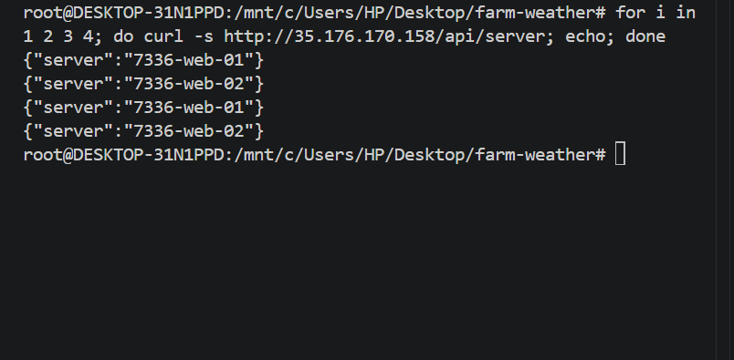
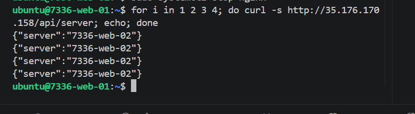
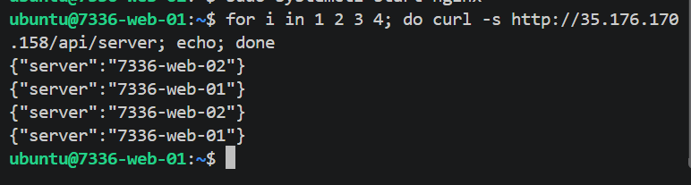

# Farm Weather Advisor

A web app that shows the 5-day weather forecast for any town. It also gives a simple farming tip for each day, like when to water crops. I made it for the "Playing Around with APIs" assignment.

**Demo video:* https://www.loom.com/share/ed01cac589b64943b1291ea38ca43081
**Live app (load balancer):** http://35.176.170.158
**Web01:** http://18.175.143.138 | **Web02:** http://3.8.8.209

## Features
- Search any town (for example `Juba`, `Wau`, `Kigali,RW`)
- Daily temperature, humidity, rain chance and wind
- A farm tip for each day
- Sort by date, hottest, coolest, rain chance or humidity
- Filter for rainy days, hot days or cooler days
- Clear error messages if the town is wrong or the API is down
- Results are saved for 10 minutes to use fewer API calls

## API used
OpenWeatherMap 5-day forecast API. I used the free plan (60 calls per minute).
- Docs: https://openweathermap.org/forecast5
- Pricing and limits: https://openweathermap.org/full-price

Weather data © [OpenWeather](https://openweathermap.org). Thank you to the OpenWeather team.

My API key is not in this repository. It is in a `.env` file that `.gitignore` blocks. The server calls the API, so the key never reaches the browser. The key for grading is in the submission comment.

## Run it locally
1. Get a free key at https://home.openweathermap.org/api_keys. A new key can take 1 to 2 hours to start working.
2. Download the project and install it:
   ```
   git clone https://github.com/Ahoi-Priscilla-Chol/farm-weather.git
   cd farm-weather
   npm install
   ```
3. Make a `.env` file like `.env.example` and add your key:
   ```
   PORT=3000
   OPENWEATHER_API_KEY=your_key_here
   ```
4. Run `node server.js` and open http://localhost:3000

## Deployment
The app runs on two web servers (Web01 and Web02) behind one load balancer (Lb01).

**On Web01 and Web02 (same steps on both):**
1. Log in with `ssh ubuntu@18.175.143.138` (Web01) or `ssh ubuntu@3.8.8.209` (Web02).
2. Install Git and Node 18. Nginx was already installed.
   ```
   sudo apt update && sudo apt install -y git
   curl -fsSL https://deb.nodesource.com/setup_18.x | sudo -E bash -
   sudo apt install -y nodejs
   ```
3. Download the project and install it, then make the `.env` file with my key:
   ```
   git clone https://github.com/Ahoi-Priscilla-Chol/farm-weather.git
   cd farm-weather && npm install
   ```
4. Keep the app running in the background with pm2:
   ```
   sudo npm install -g pm2
   pm2 start server.js --name farm-weather
   pm2 startup
   pm2 save
   ```
5. Set up Nginx to send port 80 to the app on port 3000. In `/etc/nginx/sites-available/default`:
   ```
   server {
       listen 80 default_server;
       server_name _;
       location / {
           proxy_pass http://127.0.0.1:3000;
           proxy_set_header Host $host;
       }
   }
   ```
   Then run `sudo nginx -t` and `sudo systemctl reload nginx`.

**Load balancer (Lb01, HAProxy):** the file `/etc/haproxy/haproxy.cfg` shares visitors between the two servers:
```
frontend http_front
    bind *:80
    default_backend http_back

backend http_back
    balance roundrobin
    server 7336-web-01 18.175.143.138:80 check
    server 7336-web-02 3.8.8.209:80 check
```
`roundrobin` sends visitors to each server in turn. `check` stops sending visitors to a server that is down.

## How I tested the load balancer
- From my own computer I ran `for i in 1 2 3 4; do curl -s http://35.176.170.158/api/server; echo; done`. The answers changed between `7336-web-01` and `7336-web-02`, so the load balancer shares the requests.
- In the browser at http://35.176.170.158, the footer "Served by" shows which server answered.

## Servers and failover
My servers and their IP addresses:


Both servers answer the requests:



I stopped Nginx on Web01. The load balancer saw that Web01 was down, and all requests went to Web02, so the site stayed online:



I started Nginx on Web01 again, and both servers answer again:



## Challenges
- **Typos in my code** stopped the search at first. I fixed them using the red errors in the browser console.
- **My files looked empty** because VS Code and my terminal used different folders (Windows and Linux). I used `pwd` and `find` to find them.
- **Port 3000 was already in use** by an old copy of the app. I found it with `ss -tlnp` and stopped it.
- **The servers blocked port 3000 from outside**, so I used Nginx on port 80.
- **My API key showed in a screenshot.** I made a new key, updated all three machines and deleted the old one.
- **Browsers reuse one connection**, so two browser windows often showed the same server. I tested the load balancer with `curl`, which starts a new connection each time.

## Notes
- The site uses `http`, so Chrome says "Not secure".
- The farm tips are simple rules in my code. They are not expert farming advice.

## Credits
Weather data © OpenWeather. Built with Express, dotenv and pm2 (open-source tools).
